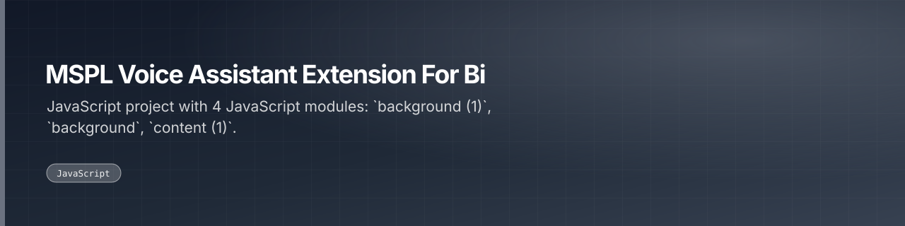

Voice-controlled Chrome extension for MSPL that opens Power BI dashboards by spoken command.

 

 

---

## What this is

The voice-driven variant of the MSPL dashboard extension, adding spoken commands to open Power BI dashboards. Carries two generations of the background and content scripts side by side.

|  |
|:--:|
| **1** |
| docs |

---

<a href="https://github.com/gowtham-creator/MSPL-voice-assistant-extension-for-bi-">gowtham-creator/MSPL-voice-assistant-extension-for-bi-</a>

